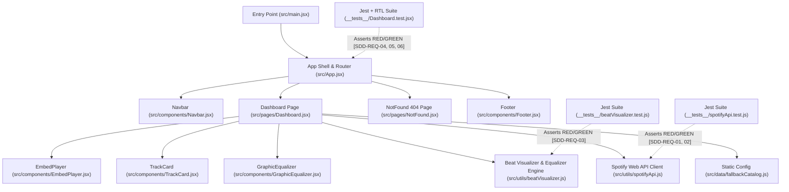

# Artifact 4: Architectural Diagram

## 1. Physical File Tree

> [!NOTE]
> This is the strict physical boundary of the system. Do not create files outside of this structure without explicit BI approval.

```text
spotifyClone/
├── artifacts/
│   ├── 01-project-overview.md
│   ├── 02-walkthrough.md
│   ├── 03-implementation-plan.md
│   ├── 04-architectural-diagram.md
│   ├── 05-logic-flowcharts.md
│   ├── 06-code-diff-specs.diff
│   └── 07-task-list.md
├── src/
│   ├── utils/
│   │   ├── spotifyApi.js
│   │   └── beatVisualizer.js
│   ├── data/
│   │   └── fallbackCatalog.js
│   ├── components/
│   │   ├── Navbar.jsx
│   │   ├── Footer.jsx
│   │   ├── GraphicEqualizer.jsx
│   │   ├── TrackCard.jsx
│   │   └── EmbedPlayer.jsx
│   ├── pages/
│   │   ├── NotFound.jsx
│   │   └── Dashboard.jsx
│   ├── App.jsx
│   └── main.jsx
├── __tests__/
│   ├── spotifyApi.test.js
│   ├── beatVisualizer.test.js
│   └── Dashboard.test.jsx
├── index.html
├── vite.config.js
├── package.json
└── README.md
```

## 2. Component & Module Relationships



## 3. Naming Conventions & Rules

To maintain systemic integrity, the following naming conventions are strictly enforced:

- **Directories:** Lowercase (`src/utils`, `src/data`, `src/components`, `src/pages`, `__tests__`).
- **Core Logic / Components:** `camelCase.js` for pure utilities and static data modules (`spotifyApi.js`, `beatVisualizer.js`, `fallbackCatalog.js`); `PascalCase.jsx` for React components and pages (`Navbar.jsx`, `Footer.jsx`, `GraphicEqualizer.jsx`, `TrackCard.jsx`, `EmbedPlayer.jsx`, `NotFound.jsx`, `Dashboard.jsx`, `App.jsx`).
- **Test Files:** `[moduleName].test.js` for utility unit tests and `[ComponentName].test.jsx` for React Testing Library integration tests inside `__tests__/`.

## 4. Data & State Boundaries

- **Source of Truth:** `src/pages/Dashboard.jsx` owns the active catalog state (`tracks`, `timeRange`, `activePlaylistId`), error flags (`authError`, `rateLimitError`), and beat-reactive theme & 16-band graphic equalizer state (`visualState`, `isPlaying`), while `src/data/fallbackCatalog.js` provides immutable configuration constants.
- **Routing & Imports:** Unidirectional top-down data flow. `src/App.jsx` mounts the persistent `Navbar` and `Footer` around the `<Routes>` switch (`/` -> `Dashboard`, `*` -> `NotFound`). Child components (`GraphicEqualizer.jsx`, `TrackCard.jsx`, `EmbedPlayer.jsx`) receive state and callbacks strictly via props and never mutate global state or invoke `spotifyApi.js` directly.
